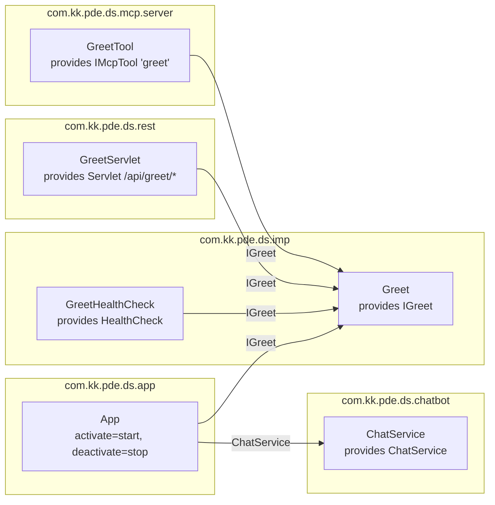
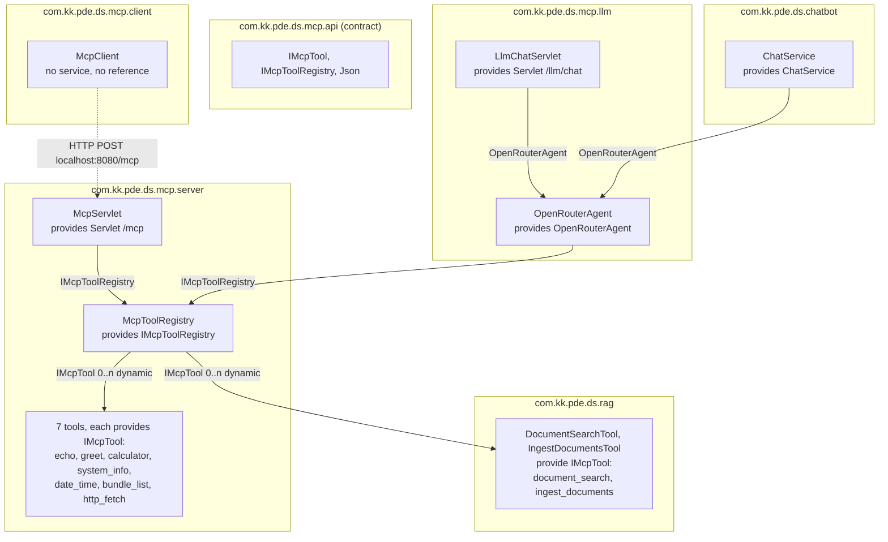
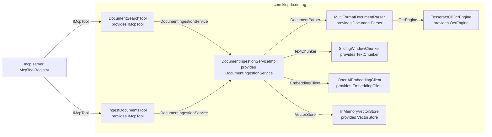
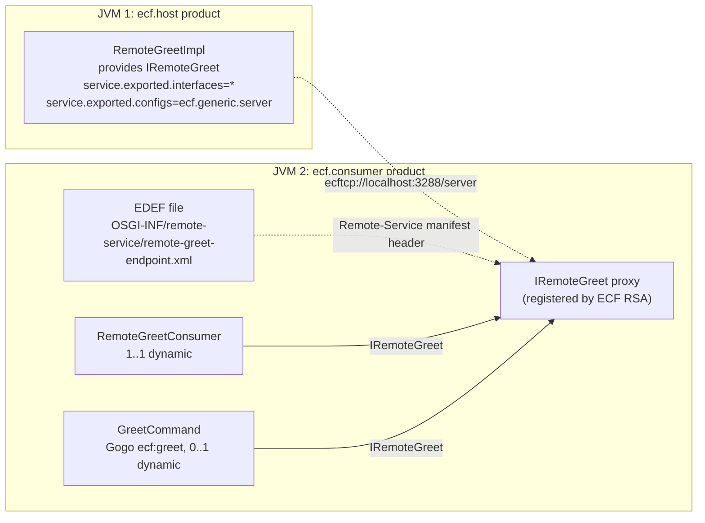
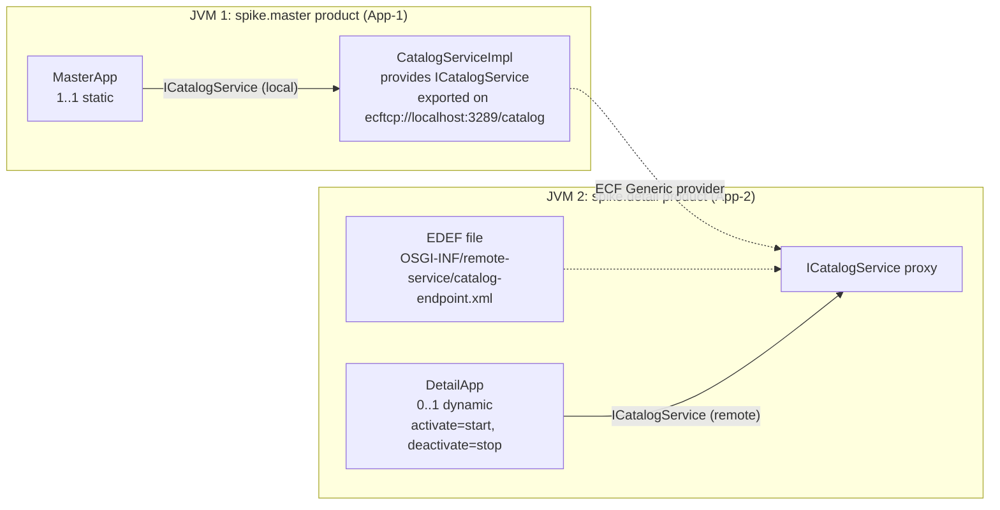

# Architecture

This document describes the 16 application bundles and their Declarative Services (DS) wiring.
Each diagram comes from the `OSGI-INF/*.xml` files, because Felix SCR reads those files.
The `.java` annotations do not control SCR in this project. See "How SCR reads the wiring".

## Three runtimes

The build makes five products. They make three separate runtimes:

| Runtime | Products | Bundles | Transport |
|---|---|---|---|
| Main product | `distribution/p2.product` | `api`, `imp`, `app`, `rest`, `mcp.api`, `mcp.server`, `mcp.client`, `mcp.llm`, `chatbot`, `rag` | HTTP on port 8080 (`org.osgi.service.http.port=8080` in `distribution/configuration/config.ini`) |
| ECF pair | `com.kk.pde.ds.ecf.host.product`, `com.kk.pde.ds.ecf.consumer.product` | `ecf.api`, `ecf.host`, `ecf.consumer` | ECF Generic provider on `ecftcp://localhost:3288/server`, static EDEF file |
| Spike pair | `com.kk.pde.ds.spike.master.product`, `com.kk.pde.ds.spike.detail.product` | `spike.api`, `spike.master`, `spike.detail` | ECF Generic provider on `ecftcp://localhost:3289/catalog`, static EDEF file |

Each ECF and spike product runs in its own JVM. These four products do not include Felix HTTP or the Felix WebConsole.

In the diagrams, a box is a DS component. A solid arrow `A --> B` means "component A has a `<reference>` to the service that B provides".
The arrow label is the service interface. A dotted arrow shows a link that is not a DS reference.

## Main product

### Greeting and REST

- `IGreet` (in `com.kk.pde.ds.api`) has four consumers: `App`, `GreetHealthCheck`, `GreetServlet` and `GreetTool`.
- `App.start()` calls `greet()`. It then opens the Clock window and the `ChatFrame` window on the Swing event thread. `App.stop()` disposes the two windows.
- `GreetHealthCheck` provides `org.apache.felix.hc.api.HealthCheck`, with `hc.name=Greet Service Health Check` and `hc.tags=application,greet`. Its `execute()` method calls `greet()`.
- `GreetServlet` registers on the HTTP Whiteboard at `/api/greet/*`.

### MCP, LLM and chatbot

- `mcp.api` exports one package, `com.kk.pde.ds.mcp.api`. It holds the `IMcpTool` and `IMcpToolRegistry` interfaces and one concrete class, `Json`. `Json` is a JSON parser and serializer with no external dependencies. `mcp.server`, `mcp.llm` and `chatbot` use it. `rag` has its own internal copy.
- `McpToolRegistry` has one reference with cardinality `0..n` and policy `dynamic`. SCR calls `addTool()` and `removeTool()` when an `IMcpTool` service comes or goes. The registry collects 9 tools: 7 from `mcp.server` and 2 from `rag`.
- `GreetTool` is the only `mcp.server` tool with a reference. It needs `IGreet`, so `mcp.server` imports `com.kk.pde.ds.api`.
- `McpServlet` speaks JSON-RPC 2.0 at `/mcp`. It handles `initialize`, `notifications/initialized`, `tools/list` and `tools/call`.
- `OpenRouterAgent` runs the agent loop for a maximum of 10 turns. It gets each tool from the registry and calls `execute()` in the same JVM. It does not use `/mcp`.
- `LlmChatServlet` (`/llm/chat`) calls `OpenRouterAgent.chat()` with a new history for each request. `ChatService` keeps a history list and calls `OpenRouterAgent.chatWithHistory()`.
- `McpClient` has no DS reference, and its manifest imports no project package. It speaks only HTTP. It waits 3 seconds after activation, then sends these requests to `http://localhost:8080/mcp`:
  1. `initialize`
  2. `notifications/initialized`
  3. `tools/list`
  4. `tools/call` for `echo`
  5. `tools/call` for `greet`
  6. `tools/call` for `system_info`

### Document Q&A (RAG)

- The `rag` bundle has 8 components. The service interfaces are in the exported package `com.kk.pde.ds.rag.api`.
- `DocumentIngestionServiceImpl` reads `-Drag.docs.dir` at activation. When the property has a value, the component ingests that folder.
- The two tools register as `IMcpTool`. Thus the registry, `/mcp` and the LLM agent get them with no change to another bundle.
- `TesseractCliOcrEngine` is the only component that starts an external process (`tesseract`).

## ECF pair

1. `RemoteGreetImpl` (`ecf.host`) registers `IRemoteGreet` with the `service.exported.*` properties. ECF Remote Service Admin (RSA) exports it on `ecftcp://localhost:3288/server`.
2. The `Remote-Service` header in the `ecf.consumer` manifest points to the EDEF file. ECF RSA reads the file, connects to the host and registers a proxy `IRemoteGreet`.
3. `RemoteGreetConsumer` and `GreetCommand` bind the proxy. `RemoteGreetConsumer` calls `greet("ECF")`. `GreetCommand` gives the Gogo command `ecf:greet`.

## Spike pair

- `spike.api` holds `ICatalogService` and the serializable value objects `CatalogItem`, `DockLayout`, `DockState`, `DockBounds` and `AnchorState`.
- `MasterApp` binds the local `CatalogServiceImpl`, not a proxy. `CatalogServiceImpl` keeps the catalog data and the selection.
- `DetailApp` binds the remote proxy. It polls `getDockState()` every 120 ms on a background thread.
- Results and run steps: [spike-isolation-results.md](spike-isolation-results.md).

## Bundle roles

| Bundle | Runtime | Components (from `OSGI-INF`) | Provides | References |
|---|---|---|---|---|
| `com.kk.pde.ds.api` | Main | none | exports `IGreet` | none |
| `com.kk.pde.ds.imp` | Main | `Greet`, `GreetHealthCheck` | `IGreet`, `HealthCheck` | `GreetHealthCheck` → `IGreet` |
| `com.kk.pde.ds.app` | Main | `App` | none | `IGreet`, `ChatService` |
| `com.kk.pde.ds.rest` | Main | `GreetServlet` | `Servlet` at `/api/greet/*` | `IGreet` |
| `com.kk.pde.ds.mcp.api` | Main | none | exports `IMcpTool`, `IMcpToolRegistry`, `Json` | none |
| `com.kk.pde.ds.mcp.server` | Main | `McpToolRegistry`, `McpServlet`, 7 tools | `IMcpToolRegistry`, `Servlet` at `/mcp`, 7 × `IMcpTool` | `IMcpTool` (0..n dynamic), `IMcpToolRegistry`, `IGreet` (`GreetTool`) |
| `com.kk.pde.ds.mcp.client` | Main | `McpClient` | none | none (HTTP only) |
| `com.kk.pde.ds.mcp.llm` | Main | `OpenRouterAgent`, `LlmChatServlet` | `OpenRouterAgent`, `Servlet` at `/llm/chat` | `IMcpToolRegistry`, `OpenRouterAgent` |
| `com.kk.pde.ds.chatbot` | Main | `ChatService` | `ChatService` | `OpenRouterAgent` |
| `com.kk.pde.ds.rag` | Main | 8 components (see the RAG diagram) | 6 pipeline services, 2 × `IMcpTool` | internal services only |
| `com.kk.pde.ds.ecf.api` | ECF pair | none | exports `IRemoteGreet` | none |
| `com.kk.pde.ds.ecf.host` | ECF pair | `RemoteGreetImpl` | `IRemoteGreet` (exported) | none |
| `com.kk.pde.ds.ecf.consumer` | ECF pair | `RemoteGreetConsumer`, `GreetCommand` | `GreetCommand` (Gogo `ecf:greet`) | `IRemoteGreet` |
| `com.kk.pde.ds.spike.api` | Spike pair | none | exports `ICatalogService` and value objects | none |
| `com.kk.pde.ds.spike.master` | Spike pair | `CatalogServiceImpl`, `MasterApp` | `ICatalogService` (exported) | `ICatalogService` (local) |
| `com.kk.pde.ds.spike.detail` | Spike pair | `DetailApp` | none | `ICatalogService` (remote proxy) |

`com.kk.pde.ds.feature`, `distribution` and `com.kk.pde.ds.target` are packaging modules. They contain no components.

## How SCR reads the wiring

Felix SCR reads the component XML files that the `Service-Component` manifest header lists. In this project, people write these XML files by hand. The build does not make them from the `@Component`, `@Reference`, `@Activate` and `@Deactivate` annotations. Thus the XML file is the source of truth, and the annotations are documentation only.

The XML file must name each lifecycle method that does not use the default name:

- SCR calls a method named `activate` when the XML has no `activate` attribute.
- SCR calls a method named `deactivate` when the XML has no `deactivate` attribute.
- Each other method name must be in the XML, for example `activate="start"`.

Example: `App.stop()` has `@Deactivate`, but `App.xml` had no `deactivate` attribute. SCR looked for `deactivate()` and did not call `stop()`. When the bundle stopped, the Clock and Chat windows stayed open. Commit `7470d2c` added `deactivate="stop"` to `App.xml`.

When you add or change a component, do these steps:

1. Change the Java class.
2. Change the XML file in `OSGI-INF/` to match the class. Include the service, each reference and each lifecycle method name.
3. Make sure that the `Service-Component` header in `META-INF/MANIFEST.MF` includes the XML file.

## Design notes

- **Contract and runtime are separate.** `mcp.api` holds the contracts and the `Json` helper. `McpToolRegistry` collects tools through a `0..n` dynamic reference. A new bundle that registers an `IMcpTool` service appears in `tools/list` with no change to `mcp.server`.
- **The LLM agent does not use HTTP to call tools.** `OpenRouterAgent` references `IMcpToolRegistry` and calls each tool in the same JVM. The `/mcp` servlet is for external MCP clients.
- **Two entry points use one agent.** `LlmChatServlet` has no history. `ChatService` keeps a multi-turn history. Both use the one `OpenRouterAgent` component.
- **Three paths use one registry.** `McpServlet`, `LlmChatServlet` and `ChatService` all reach `IMcpTool.execute()` through `McpToolRegistry`. A new tool service is available on all three paths at the same time.
- **`mcp.client` has no compile-time link to the server.** It imports no `mcp.api` or `mcp.server` package. Thus it tests the public protocol over HTTP, as an external MCP client does.
