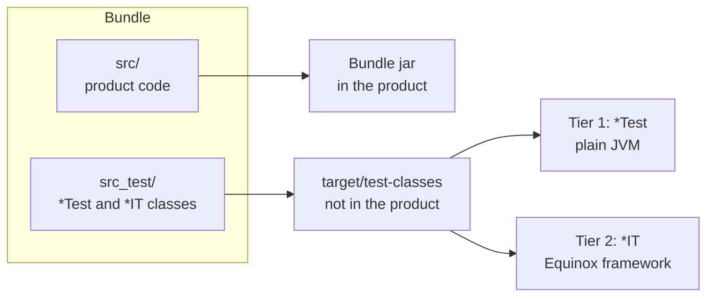
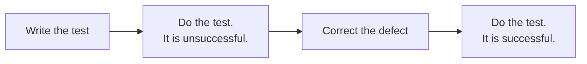
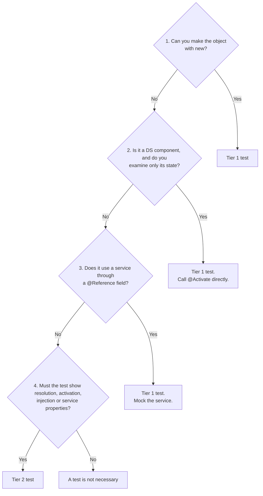
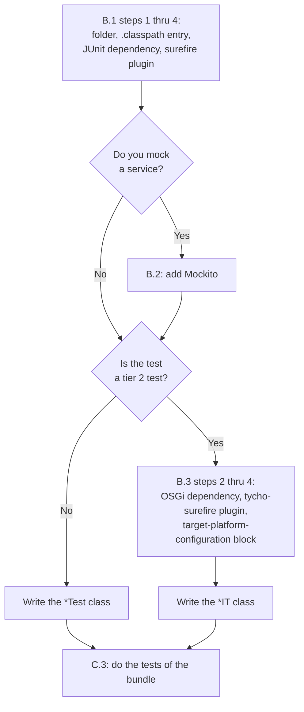
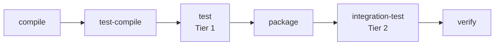

# How to Add Tests and Do Tests

This document has four parts:

- Part A tells you how to make a decision about which tests to add.
- Part B tells you how to add the tests to a bundle.
- Part C tells you how to do the tests and read the results.
- Part D tells you which tests the project has and how the two tiers operate.

The text obeys ASD-STE100 (Simplified Technical English). Names of tools, files, commands,
classes and build phases are technical names. The verbs *compile*, *resolve*, *build* and
*mock* are technical verbs.

## Basic Data

A bundle keeps its tests in the folder `src_test/`. The class name selects the tier.

| Tier | Class name | Where the tests operate | Speed |
|------|-----------|-------------------------|-------|
| Tier 1 | `*Test` | A plain JVM. There is no OSGi framework. | Fast |
| Tier 2 | `*IT` | A live Equinox framework that Tycho assembles. | Slow |

Figure 1 shows where the code of a bundle goes during a build.



*Figure 1: Product code and test code in a bundle*

---

## Part A: Make a Decision About Which Tests to Add

### A.1 When to add a test

Add a test in each of these conditions:

- You add new behavior to a bundle.
- You change behavior that has no test.
- You correct a defect. Write the test first. Make sure that the test is unsuccessful
  before the correction and successful after the correction.

Figure 2 shows the sequence for a defect.



*Figure 2: Test sequence for a defect correction*

### A.2 Select the tier

Answer these questions in sequence. Stop at the first answer "yes".

1. Can you make the object with `new` and call its methods?
   If yes, write a tier 1 test.
2. Is the object a DS component, and do you examine only its state?
   If yes, write a tier 1 test. Call the `@Activate` method directly in the test.
3. Does the object use a different service through a `@Reference` field?
   If yes, write a tier 1 test. Use Mockito to mock the service.
4. Must the test show bundle resolution, component activation, DS injection, or service
   properties?
   If yes, write a tier 2 test.

If the answer to each question is "no", a test is not necessary.

Figure 3 shows the same questions as a diagram.



*Figure 3: Selection of the tier*

**Note:** Most tests are tier 1 tests. A tier 2 test starts a framework and uses more time.
Do not write a tier 2 test for behavior that a tier 1 test can show.

### A.3 Select the type of test

Find the type of your code in this table. Then read the model class before you write the
test.

| Your code | Tests to write | Tier | Model class |
|-----------|----------------|------|-------------|
| A method that calculates a result | The usual input first. Then the limits: zero, one, the maximum, incorrect input. | 1 | `DockLayoutTest` |
| A parser or a formatter | A round trip. Special characters. Incorrect input. Input that an attacker makes. | 1 | `JsonTest` |
| A value object that goes to a different JVM | `equals` and `hashCode`. A `Serializable` round trip. | 1 | `SpikeValueObjectsTest` |
| A DS component that has state | Call `@Activate` in `@BeforeEach`. Then examine the state. | 1 | `CatalogServiceImplTest` |
| A component that calls a different service | Mock the service. Examine the result and the calls. Make the service throw an exception. | 1 | `GreetHealthCheckTest` |
| A component that calls services in a sequence | Use `ArgumentCaptor`, `InOrder` or `spy()`. | 1 | `MasterAppTest` |
| Swing code | Examine the components without a screen. Do not examine how the window looks. | 1 | `MasterAppTest` |
| A component that SCR must register as a service | The bundle is active. SCR registers the service. DS supplies the reference. | 2 | `GreetServiceIT` |
| A service that must have specified properties | SCR calls `@Activate`. The service has the properties. | 2 | `CatalogServiceIT` |

The smallest test in the project is `GreetTest`. Read it first if JUnit 5 is new to you.

### A.4 Tests that are not necessary

Do not write these tests:

- A test for a method that only gets or sets a field.
- A test for the behavior of a library or of the OSGi framework.
- A tier 2 test for a bundle that contains only an API. Such a bundle registers no service.
- A tier 2 test that uses only `new`. Write a tier 1 test.
- A second test that examines the same behavior as a test that you have.

### A.5 How many tests to write

For each behavior, write these tests:

1. One test for the usual condition.
2. One test for each limit of the input.
3. One test for each error that the code must find.

Write one behavior in each test method. Give the method a name that tells the behavior, for
example `scrRegistersIGreet`.

---

## Part B: Add the Tests

Figure 4 shows which procedures of this part to do.



*Figure 4: Procedures to add a test*

### B.1 Add a tier 1 test to a bundle

Do steps 1 thru 4 only one time for each bundle.

1. Make the folder `src_test/` in the bundle.
2. Add this entry to the file `.classpath` of the bundle, before the entry
   `kind="output"`:

   ```xml
   <classpathentry kind="src" output="bin_test" path="src_test">
       <attributes>
           <attribute name="test" value="true"/>
       </attributes>
   </classpathentry>
   ```

3. Add the test dependencies to the `pom.xml` of the bundle. Do not write versions. The
   parent `pom.xml` controls the versions.

   ```xml
   <dependencies>
       <dependency>
           <groupId>org.junit.jupiter</groupId>
           <artifactId>junit-jupiter</artifactId>
       </dependency>
   </dependencies>
   ```

4. Add `maven-surefire-plugin` to the `pom.xml` of the bundle:

   ```xml
   <build>
       <plugins>
           <plugin>
               <groupId>org.apache.maven.plugins</groupId>
               <artifactId>maven-surefire-plugin</artifactId>
           </plugin>
       </plugins>
   </build>
   ```

5. Make a class with the suffix `Test` in `src_test/`. Use the same package as the class
   that you examine.

   ```java
   package com.kk.pde.ds.imp;

   import static org.junit.jupiter.api.Assertions.assertEquals;

   import org.junit.jupiter.api.Test;

   public class GreetTest {

       @Test
       void greetingReturnsHelloWorld() {
           assertEquals("Hello world!", new Greet().greeting());
       }
   }
   ```

6. Do the tests of the bundle (refer to paragraph C.3).

**Note:** The file `com.kk.pde.ds.mcp.api/pom.xml` is a complete example of a tier 1
bundle.

### B.2 Add Mockito to a tier 1 test

1. Add these dependencies to the `pom.xml` of the bundle, without versions:

   - `org.junit.platform:junit-platform-launcher`
   - `org.mockito:mockito-core`
   - `org.mockito:mockito-junit-jupiter`
   - `net.bytebuddy:byte-buddy`
   - `net.bytebuddy:byte-buddy-agent`

2. Put `@ExtendWith(MockitoExtension.class)` on the test class.
3. Put `@Mock` on a field for each service that you mock.
4. Put `@InjectMocks` on a field for the object that you examine.

**Note:** `@InjectMocks` also sets a private `@Reference` field. Refer to
`GreetHealthCheckTest`.

### B.3 Add a tier 2 test to a bundle

Do this procedure only if paragraph A.2 gives the answer "tier 2".

1. Do steps 1 thru 4 of paragraph B.1.
2. Add these dependencies to the `pom.xml`, without versions:

   - `org.junit.platform:junit-platform-launcher`
   - `org.osgi:org.osgi.framework`

3. Add `tycho-surefire-plugin` to the `<build><plugins>` section of the `pom.xml`:

   ```xml
   <plugin>
       <groupId>org.eclipse.tycho</groupId>
       <artifactId>tycho-surefire-plugin</artifactId>
   </plugin>
   ```

4. Copy the `target-platform-configuration` block from `com.kk.pde.ds.imp/pom.xml` into
   the same section.
5. Make a class with the suffix `IT` in `src_test/`:

   ```java
   package com.kk.pde.ds.imp;

   import static org.junit.jupiter.api.Assertions.assertEquals;
   import static org.junit.jupiter.api.Assertions.assertNotNull;

   import org.junit.jupiter.api.Test;
   import org.osgi.framework.Bundle;
   import org.osgi.framework.BundleContext;
   import org.osgi.framework.FrameworkUtil;
   import org.osgi.framework.ServiceReference;

   import com.kk.pde.ds.api.IGreet;

   public class GreetServiceIT {

       private final BundleContext context = FrameworkUtil.getBundle(Greet.class).getBundleContext();

       @Test
       void bundleIsActive() {
           assertEquals(Bundle.ACTIVE, FrameworkUtil.getBundle(Greet.class).getState());
       }

       @Test
       void scrRegistersIGreet() {
           ServiceReference<IGreet> ref = context.getServiceReference(IGreet.class);
           assertNotNull(ref, "IGreet was not registered");
       }
   }
   ```

6. Do the tests of the bundle (refer to paragraph C.3).

**Note:** The OSGi manifest of the Jupiter engine requires the launcher capability.
Without `junit-platform-launcher`, tier 2 cannot resolve. Tier 1 does not need it.

**Note:** The block in step 4 does two things. It stops the check of the Java version of
the bundle. It also adds Felix SCR to the framework. If SCR is not there, no DS component
starts.

### B.4 Rules for all tests

- Do not put tests in `src/test/java`. The folder is in the source root `src/`, and Tycho
  compiles the tests into the bundle.
- Do not add the folder `src_test/` to `build.properties`.
- Do not add a test library to the target platform or to a manifest.
- Do not add a test library to `feature.xml` or to a product file.
- Do not use Mockito in a tier 2 class. Mockito is not in the Equinox framework.
- If the test makes Swing components, add `<argLine>-Djava.awt.headless=true</argLine>` to
  the configuration of the two plugins. Refer to `com.kk.pde.ds.spike.master/pom.xml`.

### B.5 Make sure that no test library ships

Do this procedure after a full build (paragraph C.1).

1. Make sure that `distribution/target/products/**` and
   `distribution/target/repository/plugins/` contain no `org.mockito.*`,
   `net.bytebuddy.*`, `org.objenesis` or `junit-*` bundle.
2. Enter `unzip -l <bundle jar>` for each bundle that has tests.
3. Make sure that the list contains no `*Test.class` and no `*IT.class` file.

If a test file or a test library is in the product, do one of these corrections:

- Remove the test folder from `build.properties`.
- Give the test dependency the scope `test`.

---

## Part C: Do the Tests

Do all commands in the project root.

Use the Maven Wrapper `./mvnw` (on Windows, `mvnw.cmd` in `cmd.exe` or `.\mvnw.cmd` in
PowerShell). It uses Maven 3.9.16. Tycho 4.0.13
does not start on Maven 3.10. CI uses `./mvnw` with the same goals.

**Note:** Tycho 4 must have JDK 17 or later. CI uses Temurin 21. To get the same result as
CI on macOS, put `JAVA_HOME=$(/usr/libexec/java_home -v 21)` before the command.

Figure 5 shows the build phases and the tier that each phase does. The command `./mvnw test`
stops after the phase `test`. The command `./mvnw verify` does all phases.



*Figure 5: Build phases and tiers*

### C.1 Do all bundle tests

1. Enter this command:

   ```bash
   ./mvnw clean verify
   ```

2. Make sure that the last lines show `BUILD SUCCESS`.

This command does tier 1 and tier 2. CI uses the same command.

### C.2 Do only tier 1

1. Enter this command:

   ```bash
   ./mvnw test
   ```

This command does not start Equinox.

### C.3 Do the tests of one bundle

1. Find the bundles that the bundle uses through its manifest.
2. Enter the command with the target module, those bundles, and the bundle:

   ```bash
   ./mvnw verify -pl com.kk.pde.ds.target,com.kk.pde.ds.api,com.kk.pde.ds.imp
   ./mvnw verify -pl com.kk.pde.ds.target,com.kk.pde.ds.mcp.api
   ./mvnw verify -pl com.kk.pde.ds.target,com.kk.pde.ds.spike.api,com.kk.pde.ds.spike.master
   ```

**Caution:** Do not use `-pl <module> -am`. Maven cannot read OSGi manifest dependencies.
The option `-am` builds only the parent, and the build stops.

### C.4 Do one tier 1 class or one tier 1 method

1. Use the property `-Dtest` with the phase `test`:

   ```bash
   ./mvnw test -pl com.kk.pde.ds.target,com.kk.pde.ds.api,com.kk.pde.ds.imp -Dtest=GreetHealthCheckTest
   ./mvnw test -pl com.kk.pde.ds.target,com.kk.pde.ds.spike.api,com.kk.pde.ds.spike.master -Dtest='MasterAppTest#spyRunsTheRealServiceAndRecordsCalls'
   ```

2. If the value contains `#`, put the value between quotation marks.

**Windows `cmd.exe`:** Use `mvnw.cmd` with the same arguments. Use double quotation marks
for a value that contains `#`. `cmd.exe` does not remove single quotation marks, so Maven
finds no test.

```cmd
mvnw.cmd test -pl com.kk.pde.ds.target,com.kk.pde.ds.spike.api,com.kk.pde.ds.spike.master -Dtest="MasterAppTest#spyRunsTheRealServiceAndRecordsCalls"
```

**Windows PowerShell:** Use `.\mvnw.cmd`. Put each `-D` argument in double quotation marks.
PowerShell cuts an argument such as `-Dit.test=GreetServiceIT` at the period, and Maven
stops with `Unknown lifecycle phase ".test=GreetServiceIT"`.

```powershell
.\mvnw.cmd test -pl com.kk.pde.ds.target,com.kk.pde.ds.api,com.kk.pde.ds.imp "-Dtest=GreetHealthCheckTest"
.\mvnw.cmd test -pl com.kk.pde.ds.target,com.kk.pde.ds.spike.api,com.kk.pde.ds.spike.master "-Dtest=MasterAppTest#spyRunsTheRealServiceAndRecordsCalls"
.\mvnw.cmd verify -pl com.kk.pde.ds.target,com.kk.pde.ds.api,com.kk.pde.ds.imp "-Dit.test=GreetServiceIT"
```

**Note:** Tier 1 uses `-Dtest` and tier 2 uses `-Dit.test`. The two properties are
different on purpose. If the two plugins read the same property, a `*Test` class can go
into Equinox, where Mockito is not available. Or an `*IT` class can go into the plain
JVM, where there is no framework.

### C.5 Do one tier 2 class

1. Use the property `-Dit.test` with the phase `verify`:

   ```bash
   ./mvnw verify -pl com.kk.pde.ds.target,com.kk.pde.ds.api,com.kk.pde.ds.imp -Dit.test=GreetServiceIT
   ```

Tier 1 also operates during this command. For Windows, refer to the notes in paragraph C.4.

### C.6 Do the tests of the migration tool

The tool `tools/pde2tycho` is not a part of the Tycho reactor. The command in paragraph C.1
does not do its tests.

1. Enter this command:

   ```bash
   ./mvnw -f tools/pde2tycho verify
   ```

CI runs these two commands in this sequence:

1. `./mvnw --batch-mode --no-transfer-progress clean verify`
2. `./mvnw --batch-mode --no-transfer-progress -f tools/pde2tycho verify`

### C.7 Read the results

The console shows one line for each class and one line for each tier:

```
Tests run: N, Failures: 0, Errors: 0, Skipped: 0
```

Use these lines to find the result. Do not look for the word `ERROR` in the log.

| Tier | Report folder |
|------|---------------|
| Tier 1 | `<bundle>/target/surefire-reports/` |
| Tier 2 | `<bundle>/target/failsafe-reports/` |

Tycho uses the failsafe folder layout for tier 2. Each class gets one `*.txt` summary and
one `TEST-*.xml` file.

**Note:** `GreetHealthCheckTest` has a `@Nested` class, `WithAnnotations`. Its `*.txt`
summary shows `Tests run: 0`, but `TEST-com.kk.pde.ds.imp.GreetHealthCheckTest.xml`
contains the 6 test cases. Use the total for the bundle. For tier 1 of `imp`, the total is 7.

These lines in the log are normal:

- `Mockito is currently self-attaching`. Mockito attaches a Java agent.
- `ERROR ... Greet Service Health Check failed`. Three tests in `GreetHealthCheckTest`
  cause this error on purpose.

### C.8 Fault isolation

| Symptom | Cause | Correction |
|---------|-------|------------|
| `requires osgi.bundle ... but it could not be found` after `-pl <module> -am` | Maven cannot read OSGi manifest dependencies. | List the target module and the necessary bundles in `-pl` (refer to paragraph C.3). |
| The new tests do not start. | The class name has no suffix `Test` or `IT`, or the `pom.xml` does not list the plugin. | Correct the class name. Do steps 3 and 4 of paragraph B.1. |
| The compiler cannot find JUnit classes. | The `pom.xml` of the bundle has no test dependency. | Do step 3 of paragraph B.1. |
| A tier 1 test cannot get a bundle or a `BundleContext`. | Tier 1 has no OSGi framework. | Change the suffix of the class to `IT`. Do paragraph B.3. |
| A tier 2 test finds no service. | Felix SCR is not in the framework. | Do step 4 of paragraph B.3. |
| A tier 2 test cannot find Mockito classes. | Mockito is not in the Equinox framework. | Move the test to a `*Test` class. |
| A window opens during the tests. | The JVM has a screen. | Add the `argLine` in paragraph B.4. |
| The local result is different from the CI result. | The command `mvn` of Homebrew uses its own JDK when `JAVA_HOME` is not set. | Set `JAVA_HOME` to JDK 21 before the command. |
| Test classes are in a bundle jar. | The tests are in `src/`, or `src_test/` is in `build.properties`. | Move the tests to `src_test/` and remove the entry. |

---

## Part D: The Tests of This Project

### D.1 Test classes

The project contains eight tier 1 classes with **54 tests** and two tier 2 classes with
**6 tests**. The Javadoc of each class is a short lesson about one test idea.

| Bundle | Class | Tier | Tests | What the class teaches |
|--------|-------|------|-------|------------------------|
| `com.kk.pde.ds.imp` | `GreetTest` | 1 | 1 | **Start here.** The smallest unit test: Arrange, Act, Assert. `@Test`. How JUnit 5 finds test methods. Where tests are, and the two tiers. |
| `com.kk.pde.ds.mcp.api` | `JsonTest` | 1 | 13 | The hand-written `Json` parser: round trips, numeric and string IDs, control characters, `\uXXXX` escapes, incorrect input, and protection against JSON-RPC injection. |
| `com.kk.pde.ds.spike.master` | `DockLayoutTest` | 1 | 8 | The grid calculation that the two spike JVMs share. The usual input first, then the limits. |
| `com.kk.pde.ds.spike.master` | `SpikeValueObjectsTest` | 1 | 4 | The two contracts of a value object that goes through ECF: `equals`/`hashCode`, and a `Serializable` round trip. |
| `com.kk.pde.ds.chatbot` | `ChatConfigTest` | 1 | 6 | Settings with several sources (file, `-D`, environment, default). The difference between the saved value and the effective value. A regression test for a real bug: the Settings dialog saved a key from the environment. `@TempDir`, and how to restore system properties after a test. |
| `com.kk.pde.ds.spike.master` | `CatalogServiceImplTest` | 1 | 10 | The state of a DS component. The test calls the `@Activate` method directly from `@BeforeEach`. |
| `com.kk.pde.ds.imp` | `GreetHealthCheckTest` | 1 | 6 | **Mockito, part 1.** Why a test needs a test double. A hand-written double and `mock()`. `doThrow(...).when(mock).greet()` for a `void` method. `verify`, `times(1)` and `verifyNoMoreInteractions`. `@ExtendWith(MockitoExtension.class)`, `@Mock`, and `@InjectMocks` into a private `@Reference` field. |
| `com.kk.pde.ds.spike.master` | `MasterAppTest` | 1 | 6 | **Mockito, part 2.** `when(...).thenReturn(...)`, `ArgumentCaptor`, `InOrder`, `spy()` and its two problems. Swing code without a screen, with `SwingUtilities.invokeAndWait`. |
| `com.kk.pde.ds.imp` | `GreetServiceIT` | 2 | 3 | **In the framework, part 1.** The bundle is ACTIVE. SCR registers `IGreet`, and the service is a `Greet`. Real DS injection supplies the `@Reference` of the health check. |
| `com.kk.pde.ds.spike.master` | `CatalogServiceIT` | 2 | 3 | **In the framework, part 2.** SCR calls `@Activate` (five items). SCR registers `ICatalogService` with the `service.exported.*` properties that the ECF export needs. |

`com.kk.pde.ds.mcp.api` and `com.kk.pde.ds.chatbot` have no `*IT` class on purpose. `mcp.api`
contains only an API and registers no service, so a framework start can show nothing. The
`chatbot` component needs the LLM bundle and a screen, and `ChatConfigTest` already tests its logic.

Read the classes in this sequence:

1. `GreetTest`
2. `JsonTest`, `DockLayoutTest`, `SpikeValueObjectsTest`, `CatalogServiceImplTest` and `ChatConfigTest`
3. `GreetHealthCheckTest`
4. `MasterAppTest`
5. `GreetServiceIT`
6. `CatalogServiceIT`

For the design, read these specifications:

- [2026-09-16-tycho-plugin-test-migration-design.md](superpowers/specs/2026-09-16-tycho-plugin-test-migration-design.md):
  the two-tier layout, with the six items that the spike found.
- [2026-07-28-mockito-osgi-test-mocking-design.md](superpowers/specs/2026-07-28-mockito-osgi-test-mocking-design.md):
  Mockito in the test suites.

### D.2 How the two tiers operate

1. **The test sources are in the bundle.** The bundle keeps its PDE layout
   (`source.. = src/`). The `.classpath` entry has the attribute `test="true"`. Tycho
   reads the attribute and compiles `src_test/` into `target/test-classes` in the phase
   `test-compile`. `build.properties` does not list the folder, so the jar contains no
   test file.
2. **The test libraries are usual Maven dependencies with the scope `test`.** The parent
   `pom.xml` sets the versions. The setting `pomDependencies=consider` in the parent
   `target-platform-configuration` adds them to the target platform of the module. No
   manifest, `feature.xml` or `p2.product` lists them, so they never ship.
3. **Tier 1 is plain Surefire.** The Tycho `eclipse-plugin` lifecycle does not bind
   `maven-surefire-plugin`. Thus the parent `pluginManagement` has a `test` execution. A
   bundle selects it when the bundle lists the plugin. The test JVM has a flat class
   path with the bundle classes and the test dependencies. It has no framework and reads
   no manifest.
4. **Tier 2 is `tycho-surefire:plugin-test`.** For a bundle that lists
   `tycho-surefire-plugin`, Tycho does these steps:
   1. It makes a test fragment from `target/test-classes`. The bundle is the host.
   2. It assembles a temporary Equinox from the target platform. The runtime contains
      the bundle, its requirements, JUnit and the fragment.
   3. It starts the runtime through `org.eclipse.equinox.launcher`. It runs the `*IT`
      classes in it.

   The goal `verify` then stops the build if a test fails. A manifest error or an
   `Import-Package` that does not resolve causes a failure here, also when `javac`
   accepted the code.
5. **The tier 2 runtime needs two settings.** The `target-platform-configuration` block
   of each tier 2 bundle holds them:
   - `resolveWithExecutionEnvironmentConstraints` is `false`. The BREE of the bundle is
     `JavaSE-1.8`, but the Tycho test harness needs `JavaSE-17`.
   - `extraRequirements` adds Felix SCR. The Tycho packaging adds the header
     `Require-Capability: osgi.extender=osgi.component`, and no other bundle in the
     runtime supplies it.

   The parent `tycho-surefire` configuration starts SCR at start level 1, so the
   components activate.
6. **Mockito operates only in tier 1.** Its inline mock maker attaches a Java agent.
   Thus the log shows `Mockito is currently self-attaching`. The parent pins ByteBuddy
   to `1.18.13-jdk5`, because the local JVM can be newer than the CI JVM.
7. **Swing tests operate without a screen.** `com.kk.pde.ds.spike.master` gives
   `-Djava.awt.headless=true` to the JVMs of the two tiers. `MasterAppTest` calls the
   package-private method `buildPanels()`. `MasterApp.start()` has a headless guard.
   Thus no window opens when SCR activates the real component in tier 2.

## Related Documents

| Document | Contents |
|----------|----------|
| [`README.md`](../README.md) | Entry page. Its overview table links to this document. |
| `docs/adding-tests-to-a-tycho-project.md` | How to apply the two tiers to a different Tycho project. |
